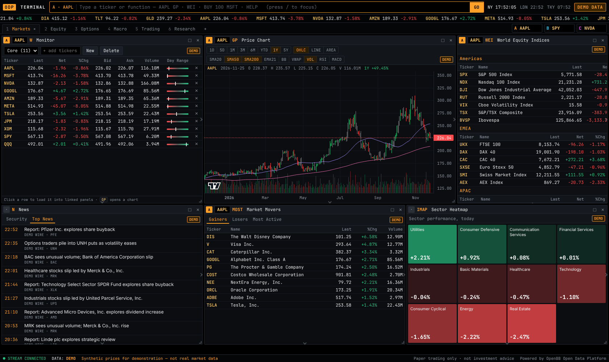

# ODP Terminal

A keyboard-driven, multi-panel workspace for trading and market research, built on the
[Open Data Platform by OpenBB](../openbb_platform). It's modelled on how professional market
terminals work: a command line, linked panels, function mnemonics, live-updating monitors and
an order blotter. It's a full-stack app:

- **Backend** (`backend/odp_terminal`): a FastAPI service that pulls data through the OpenBB
  Platform (`from openbb import obb`), streams quotes over WebSocket, runs a paper-trading engine
  and price alerts, and stores watchlists, layouts and notes in SQLite. It also mounts the full
  OpenBB REST API at `/odp`.
- **Frontend** (`frontend/`): React + TypeScript. It uses TradingView Lightweight Charts for the
  charts and react-grid-layout for draggable, resizable panels.



> Paper trading only: orders are simulated inside the server and never routed to a broker.
> Nothing here is investment advice.

## Quick start

```sh
python -m venv .venv && source .venv/bin/activate   # Python 3.11–3.13
./terminal/install.sh      # OpenBB core + key-free providers (editable, from this repo) + terminal server
./terminal/run.sh          # builds the UI on first run, then serves http://127.0.0.1:6901
```

`install.sh` installs only the OpenBB packages the terminal uses. It skips the EIA, BLS, OECD
and ECB providers because their build steps download catalogs (EIA also needs an
`EIA_API_KEY`), so `openbb_platform/dev_install.py` fails on a fresh clone without them.

`run.sh` builds the UI on first run (Node 18+). After that, `python -m odp_terminal` or
`odp-terminal` starts the server directly.

Options: `--mode auto|live|demo`, `--port`, `--host`, `--db PATH`, and `--no-odp` (don't mount
the OpenBB REST API). Each option also has an environment variable: `TERMINAL_DATA_MODE`,
`TERMINAL_PORT`, `TERMINAL_HOST`, `TERMINAL_DB`, `TERMINAL_MOUNT_ODP=0`.

The server binds to `127.0.0.1` by default. On any other address (`--lan` or `--host`) it
requires an access token. See *Use it on an iPad*.

## Use it on an iPad

The terminal installs on iPad as a home-screen web app: it gets its own icon, opens full-screen
and has a touch layout. That layout has a ☰ MENU for every function, larger controls, and a
single-column panel stack in portrait. The data server can't run on iPadOS, so the iPad connects
to a server running elsewhere. There are two ways to set that up.

**A. On your own computer (same Wi-Fi as the iPad)**

```sh
./terminal/install.sh
./terminal/run.sh --lan
```

`--lan` serves on your local network and requires an access token. If `TERMINAL_TOKEN` isn't
set, it generates one. It prints the iPad address and a QR code. On the iPad:

1. Scan the QR code with the Camera app and open the link in Safari.
2. Tap **Share → Add to Home Screen**.

The icon opens the terminal directly. The computer has to be on and running the server while
you use it.

**B. On a cloud host (works anywhere)**

Build the container from the repository root and run it on any Docker host (Fly.io, Render,
Railway, a VPS). Use HTTPS and set your own token:

```sh
docker build -f terminal/Dockerfile -t odp-terminal .
docker run -p 6901:6901 -e TERMINAL_TOKEN=<long-random-string> -v odp-data:/data odp-terminal
```

Open `https://<your-host>/?token=<token>` on the iPad, then tap **Share → Add to Home Screen**.
Watchlists, layouts, trades and alerts are stored in `/data`, so keep that volume.

The token can be sent as a bearer header, a `?token=` query parameter, or a long-lived HttpOnly
login cookie. The app shows an unlock screen if it doesn't have the token. Home-screen apps on
iOS keep their own storage, so if the unlock screen appears there, enter the token once.

### Frontend development

```sh
cd terminal/frontend
npm install
npm run dev        # http://localhost:5173, proxies /terminal and /odp to :6901
npm test           # parser, indicator and formatting unit tests
```

## Data modes

| Mode | Behaviour |
|------|-----------|
| `auto` (default) | At startup the server probes a live quote through OpenBB. If the probe succeeds it serves live data; otherwise it serves demo data. It re-probes every 5 minutes. |
| `live` | Always uses OpenBB providers. A failed request returns an error (HTTP 503). |
| `demo` | Synthetic, deterministic data from `demo.py`, so the whole workspace works offline. |

Live and demo data are **never mixed**. When a live request fails you get an error, not fake
numbers. Every response carries `source: "live" | "demo"`, and the UI puts a **DEMO** or
**LIVE · PROVIDER** badge on every panel. A banner in the status bar also says when prices are
synthetic. You can switch modes at runtime with `MODE demo` in the command line or in Settings
(`SET`).

Live data uses key-free providers by default, falling back through a chain per dataset:

| Dataset | Providers (in order) |
|---------|---------------------|
| Quotes, price history | cboe → nasdaq → tmx |
| Profile | nasdaq → tmx → finra |
| Fundamentals | nasdaq → sec → tmx |
| Options chains | cboe → nasdaq → tmx |
| News | nasdaq → tmx |
| Yield curve | federal_reserve → fred |
| Economic / earnings calendar | nasdaq (→ fred / tmx) |
| Filings, insiders | sec → nasdaq → tmx |
| FX / crypto history | tmx / nasdaq |
| Commodities (spot) | fred (needs a free FRED API key) |

You can set provider API keys for the session in Settings, or persist them in
`~/.openbb_platform/user_settings.json`. The **OpenBB Data Explorer** (`API`) panel can run any
of the roughly 450 installed OpenBB commands and export the result to CSV.

## Using it

Type into the command line (press `/` to focus it):

| Input | Action |
|-------|--------|
| `AAPL` | Load AAPL into the focused link group |
| `AAPL GP` or `GP AAPL` | Open a function for a security (Bloomberg-style `<Equity>`/`<GO>` keywords are ignored) |
| `WEI`, `ECO`, `GC`, `MOST`… | Open a market-wide function |
| `BUY 100 AAPL` · `SELL 50 MSFT LMT 410 GTC` · `SELL 10 TSLA STP 200` | Paper orders: market, limit, stop or stop-limit; DAY or GTC |
| `ALRT AAPL > 250` · `ALRT SPY %< -2` | Price or %-change alerts, delivered as toasts and browser notifications |
| `PAGE 2` · `NEW Ideas` · `SAVE name` · `LOAD name` | Pages and saved layouts |
| `MODE live` | Switch data mode |
| `HELP` | Function directory |

Keyboard shortcuts: `Alt+1…9` switches page, `Alt+M` maximizes the focused panel, `Alt+W` closes
it, `Tab` accepts a suggestion and `↑/↓` scrolls command history.

**Linking.** Each panel has a link group: A (amber), B (cyan), C (magenta), or unlinked. Panels
in the same group follow one security. Clicking a row in a monitor, movers table or portfolio
loads that security into the group. Click the colored square on a panel to change its group.

### Functions

| Mnemonic | Panel |
|----------|-------|
| `GP` / `GIP` | Price chart (daily / intraday). Candles, line or area; SMA 20/50/200, EMA 21, Bollinger, VWAP, volume, RSI and MACD panes. The last bar updates from the stream. |
| `DES` | Quote, key statistics, company description |
| `FA` | Income statement, balance sheet, cash flow; annual or quarterly, with growth |
| `OMON` | Option chain with IV and delta, IV smile, open-interest profile, put/call ratios |
| `TECH` | Rule-based technical signals (trend stack, crosses, RSI, MACD, 52-week position, volatility regime, volume) |
| `CF` | Filings and insider transactions |
| `N` | Security or top news |
| `W` | Watchlist monitor with streaming quotes; watchlists are editable and saved on the server |
| `WEI` · `FX` · `CRYP` · `CMDTY` | World indices, currencies, crypto, commodities |
| `MOST` · `IMAP` · `ERN` | Movers, sector heatmap, earnings calendar |
| `GC` · `ECO` | Treasury yield curve (with 2s10s and 3m10y spreads, and comparison to a past date) and the economic calendar |
| `TKT` · `PORT` · `BLOT` · `ALRT` | Order ticket, portfolio and P&L with an equity curve, order blotter, alerts |
| `AI` | AI analyst (Claude) grounded in the terminal's own data for the security and, optionally, your paper portfolio |
| `CORR` | Return-correlation matrix for a basket |
| `API` | Run any OpenBB command |
| `NOTE` | Research notes tagged by security |
| `SET` · `HELP` | Settings (data mode, credentials, layouts) and the function directory |

### AI analyst

The `AI` panel streams answers from the Claude API (`claude-opus-5-5` by default; override it
with `TERMINAL_AI_MODEL`). To enable it, set `ANTHROPIC_API_KEY` or sign in with
`ant auth login`, and install `anthropic` (it's in the `ai` extra). Each request sends the model
a JSON snapshot of the data the terminal already holds: quote, technicals, profile, income
statement, headlines, and the portfolio if you opt in. The model is told whether that data is
live or demo. Requests use server-side refusal fallbacks (`fallbacks: "default"`). Without
credentials the panel explains how to turn it on, and the rest of the terminal works as normal.

## Architecture

```
browser ──HTTP──▶ /terminal/*   FastAPI routes (market data, trading, watchlists, layouts…)
        ◀──WS───  /terminal/ws  quote stream + order/alert/status events
                  /odp/*        full OpenBB REST API (mounted)
                         │
               MarketData ──▶ obb.<router>.<command>(provider=…)   (live)
                         └──▶ demo.py                              (demo)
               TradingEngine / alerts ──▶ SQLite (~/.odp_terminal/terminal.db)
```

A background loop polls quotes for every symbol that a client is watching, that has a working
order, or that has an active alert. It polls every 1 s in demo mode and every 5 s in live mode.
On each poll it pushes quotes to subscribers, fills orders whose conditions are met, fires
alerts, and records the account's equity once a minute.

## Tests

```sh
cd terminal/backend && pytest       # 48 tests: demo data, normalization, trading engine, API, WebSocket
cd terminal/frontend && npm test    # 16 tests: command parser, indicators, formatting
```

## Known limitations

- Live mappings follow OpenBB's standard models, but provider coverage varies. Intraday bars,
  FX, crypto and movers depend on what the key-free providers return for a given symbol. When
  a dataset is unavailable, the panel shows the provider's error.
- Live commodities need a FRED API key.
- The paper-trading engine fills against the top of book (with configurable slippage). It does
  not model partial fills, queue position or market hours.
- The server is single-user: one shared access token, no per-user accounts.
